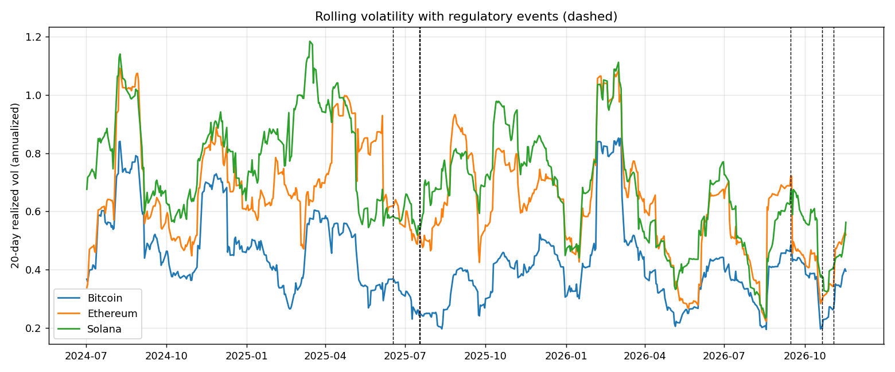

# Crypto Regulation Event Study: Chart Guide, Statistical Glossary, and Findings

**Project hypothesis:** Crypto prices are more sensitive to regulatory announcements than to underlying economic and financial factors. *(Note: As detailed below, this original hypothesis was rejected by the data).*

**Events tested:** GENIUS Act Senate passage (2025-06-17), CLARITY Act House passage (2025-07-17), GENIUS Act signed (2025-07-18), CLARITY Act Senate cloture failure (2026-09-15).

**Assets tested:** Bitcoin (BTC), Ethereum (ETH), Solana (SOL), and Coinbase stock (COIN). Coinbase is analyzed as a "regulation-exposed" asset because its entire business model relies on U.S. compliance.

**Control variables:** S&P 500 (broader stock market health), VIX (market fear gauge), and 10-year Treasury yield (benchmark interest rates).

---

## Statistical Glossary: How to Read the Metrics

Before reviewing the findings, it is essential to understand the statistical terms used throughout this project:

* **CAR (Cumulative Abnormal Return):** The core measurement of the study. It calculates how much an asset's price went up or down *above and beyond* what normal economic conditions (the S&P 500, interest rates, and market fear) would have predicted. 
* **t-stat (T-statistic):** A statistical metric used to determine whether a result is real or just random chance. In financial studies, **a t-stat must be roughly above 2 or below -2** in absolute value to be considered "statistically significant." If it is below 2, the price movement cannot be distinguished from normal market noise.
* **p-value:** The probability that a result happened purely by chance. A standard threshold is $0.05$ (or $5\%$). A p-value *below* $0.05$ indicates a reliable, statistically meaningful result. A p-value *above* $0.05$ means we cannot trust that the event caused the price shift.
* **$R^2$ (R-squared):** A percentage score showing how much of an asset's price movement can be explained by a specific group of factors. For example, if macro factors have an $R^2$ of $20\%$, it means traditional markets explain $20\%$ of that asset's day-to-day movement.
* **Beta ($\beta$):** A measure of how aggressively an asset moves relative to a benchmark (the S&P 500). A beta of $1.0$ means the asset moves in lockstep with the S&P 500. A beta of $2.8$ (observed for Coinbase) means that when the S&P 500 moves $1\%$, Coinbase typically moves $2.8\%$ in the same direction.

---

## Bottom Line (Read This First)

**The data prove that the original hypothesis is false.** 

- Out of 32 abnormal-return tests (4 events $\times$ 4 assets $\times$ 2 time windows), **only 2 results were statistically significant**, both belonging to Coinbase around the GENIUS Senate vote. By pure chance alone, 1 to 2 false positives are expected across 32 tests.
- **Bitcoin shows zero meaningful reaction** to any of the legislative events.
- **Day-to-day crypto returns are driven by the stock market**, not government regulation. The S&P 500 beta is highly significant ($p < 0.001$) for every asset, while regulatory event-day variables add virtually nothing to explanatory power.
- There is a **fast, short-lived intraday reaction on September 15, 2026**, along with **Coinbase-specific volume and price reactions**, which form the genuine empirical findings of this paper.

**Refined Thesis for the Paper:** Regulatory news matters for regulation-exposed assets (Coinbase, and to a lesser extent Ethereum and Solana) but has no impact on crypto as a whole. Traditional macro-market factors explain far more of daily crypto returns than legislation does.

---

## Chart 1: Rebased Prices Around Each Event

**What it shows:** Tracks each asset's price indexed to 100 on the day immediately preceding an event, spanning 10 trading days before and after.

**What it tells us:**
- **GENIUS Senate passes (top left):** Coinbase shares surged roughly 13% the next day and reached a 43% gain by day +6, while Bitcoin remained completely flat near 100. This is the cleanest event reaction in the entire dataset and is unique to Coinbase.
- **CLARITY House passes and GENIUS signed (top right, bottom left):** Ethereum and Solana prices spiked 10% to 17% around the event window. However, the chart reveals they were **already rallying sharply prior to the news** (Ethereum rose ~30% in the days leading up to day 0). This makes it impossible to prove the law caused the rally rather than a pre-existing bull market trend.
- **CLARITY cloture fails (bottom right):** All assets dipped initially on day 0, but subsequently rallied 5% to 16% over the following days. The failure of the bill did not cause a permanent market collapse.
- **Bitcoin stays completely flat** across all panels around day 0.

---

## Chart 2a: Abnormal Returns, $[-1, +1]$ Window

**What it shows:** Isolates the "regulation effect" by removing what the S&P 500, VIX, and interest-rate changes would have predicted over a 3-day window surrounding each event.

| Event | Bitcoin | Ethereum | Solana | Coinbase |
|---|---|---|---|---|
| GENIUS Senate passes | -1.4% ($t=-0.32$) | -1.4% ($t=-0.19$) | -0.9% ($t=-0.10$) | **+20.4% ($t=3.01$)** |
| CLARITY House passes | 0.0% ($t=-0.01$) | +12.6% ($t=1.72$) | +7.9% ($t=0.92$) | +6.7% ($t=0.92$) |
| GENIUS signed | -1.1% ($t=-0.27$) | +11.6% ($t=1.58$) | +12.2% ($t=1.42$) | +3.1% ($t=0.42$) |
| CLARITY cloture fails | -0.1% ($t=-0.02$) | -2.2% ($t=-0.41$) | -2.0% ($t=-0.37$) | -2.3% ($t=-0.36$) |

**What it tells us:**
- Only **Coinbase during the GENIUS Senate passage** reaches statistical significance (highlighted in bold, $t = 3.01$).
- Although Ethereum and Solana show positive CARs (8% to 13%), their t-stats range between 0.9 and 1.7—falling short of the required threshold of 2. These results are suggestive indications, not proven facts.
- Directionally, the results align with intuition (pro-regulation news yields positive moves for altcoins/COIN, while failure yields negative initial moves), but the statistical evidence remains weak overall.

---

## Chart 2b: Abnormal Returns, $[0, +5]$ Window

**What it shows:** Measures cumulative abnormal returns accumulated over the event day and the subsequent five trading days.

| Event | Bitcoin | Ethereum | Solana | Coinbase |
|---|---|---|---|---|
| GENIUS Senate passes | -0.3% ($t=-0.04$) | -4.1% ($t=-0.39$) | -5.2% ($t=-0.42$) | **+31.4% ($t=3.27$)** |
| CLARITY House passes | -1.2% ($t=-0.20$) | +10.1% ($t=0.97$) | +5.3% ($t=0.43$) | -3.7% ($t=-0.36$) |
| GENIUS signed | -2.3% ($t=-0.38$) | +7.3% ($t=0.71$) | +6.1% ($t=0.50$) | -7.7% ($t=-0.76$) |
| CLARITY cloture fails | +7.9% ($t=1.50$) | +5.9% ($t=0.76$) | +11.8% ($t=1.51$) | +2.5% ($t=0.27$) |

**What it tells us:**
- Coinbase's reaction to the GENIUS Act **persists and expands** (+20% to +31%), confirming it was not a fleeting one-day blip.
- For the July 2025 events, Coinbase's initial gains completely reversed (+6.7% turned into -3.7%), pointing toward an initial overreaction that faded.
- Surprisingly, the **cloture failure was followed by a positive 5-day abnormal return** across all assets. This runs counter to the expectation that regulatory failure damages crypto, likely representing market relief that stricter rules were avoided or an unrelated market rebound.

---

## Chart 3: Trading Volume Heatmap

**What it shows:** Compares event-day and post-event trading volume against the prior 30-day average. A score of 1.0x represents normal baseline activity; green indicates below-normal volume, and red indicates an active surge.

**What it tells us:**
- **Coinbase volume is heavily elevated** ($1.5\times$ to $1.8\times$ normal) across every single event, proving that COIN market participants monitor regulation closely.
- **Ethereum and Solana volume surged** ($2.5\times$ to $2.7\times$ normal) during the GENIUS Act signing, representing the strongest volume response in the dataset.
- **Bitcoin trading volume stayed mostly normal** ($0.72\times$ to $1.57\times$), reinforcing the conclusion that everyday Bitcoin traders do not alter behavior based on Washington politics.

---

## Chart 4: Rolling 20-Day Volatility

**What it shows:** Measures annualized price turbulence (risk/volatility) over a rolling 20-day window from mid-2024 through late 2026, with dashed lines marking the regulatory events.

**What it tells us:**
- Volatility **did not spike around the regulatory dates.** The mid-2025 event cluster occurred during a remarkably calm market period (Bitcoin volatility hovered near $25\%$, its lowest point in the sample).
- The **largest volatility spikes** (such as early 2026, where SOL and ETH exceeded $100\%$ annualized volatility) **have zero alignment with any regulatory event.** Macroeconomic shocks entirely dwarf legislative milestones.

---

## Chart 5: Hourly Prices on September 14 to 16, 2026

**What it shows:** Zooms in from daily data to an **hourly** frequency around the failed Senate cloture vote, tracking prices and hourly Bitcoin trading volume.

**What it tells us:**
- Around the exact hour of the vote, prices dropped sharply (**BTC -1.4%, SOL -2.0%, ETH -2.8%**), and Bitcoin trading volume spiked to ~1,300 contracts compared to a typical baseline of 100–500.
- This is the **cleanest intraday evidence of a regulatory reaction** in the project, demonstrating that high-frequency data captures immediate shocks that daily closing prices wash out.
- *Caveat:* Prices were already softening prior to the vote timestamp, and the decline fully reversed within days, confirming it was a short-term sentiment reaction.

---

## Chart 6: Variance Explained ($R^2$ Decomposition)

**What it shows:** Breaks down how much of the size of daily moves is explained by traditional macroeconomic controls (S&P 500, VIX, rates) versus adding event-day dummy variables.

| Asset | Macro $R^2$ only | Gain from event dummies | Event coefficient p-value |
|---|---|---|---|
| Bitcoin | 2.31% | +0.19 pp | 0.046 (negative sign) |
| Ethereum | 2.38% | +0.01 pp | 0.68 |
| Solana | 1.12% | +0.01 pp | 0.85 |
| Coinbase | 1.01% | +0.52 pp | 0.24 |

**The stronger macro evidence from signed-return regressions:**
| Asset | Model $R^2$ | S&P 500 Beta ($\beta$) | S&P p-value | Event dummy p-value |
|---|---|---|---|---|
| Bitcoin | 19.5% | 0.98 | <0.001 | 0.28 |
| Ethereum | 22.2% | 1.45 | <0.001 | 0.18 |
| Solana | 17.4% | 1.41 | <0.001 | 0.43 |
| Coinbase | 30.6% | 2.80 | <0.001 | 0.74 |

**What it tells us:**
- Broad macroeconomic factors explain **$17\%$ to $31\%$** of daily crypto returns, anchored by highly significant S&P 500 betas ($p < 0.001$).
- Regulatory event dummies add **under $0.15$ percentage points** to explanatory power and are never statistically significant. Traditional stock market trends dictate daily crypto returns far more than legislative news.

---

## Summary of Findings

| Research Question | Evidence Source | Final Verdict |
|---|---|---|
| Do crypto prices move more on regulatory news than macro factors? | Charts 2 & 6, Regressions | **No.** S&P 500 beta is highly significant; event dummies are not. |
| Does regulation move any specific asset? | Charts 1, 2a, 2b, 3 | **Coinbase yes** (GENIUS Senate); ETH/SOL directionally yes but insignificant; **Bitcoin no.** |
| Does regulation increase market volatility? | Chart 4 | **No visible effect.** |
| Is there a fast reaction at all? | Chart 5 | **Yes, intraday on Sept 15, 2026**, though it quickly reversed. |
| Do trading volumes respond? | Chart 3 | **Coinbase consistently; ETH/SOL on GENIUS signing; Bitcoin no.** |

## Limitations to State in the Paper
1. **Small sample size:** Only 4 events and 8 event-day observations across a 615-day regression model, resulting in low statistical power.
2. **Overlapping events:** July 17 and 18, 2025 are separated by just one day and must be treated as a single cluster.
3. **Confounding news:** Unobserved macro or crypto-specific news within the testing windows cannot be completely isolated from regulation.
4. **Pre-trends:** Ethereum and Solana were already rallying prior to the July 2025 events, confounding abnormal return attribution.
5. **Weak market model benchmark:** Using the S&P 500 as a benchmark for crypto leaves significant residual noise ($R^2$ of 12% to 22%).

## Files Included in Repository
| File Path | Description |
|---|---|
| `Output/01_rebased_prices.png` | Price reaction curves by event |
| `Output/02_CAR-1_+1.png`, `Output/02_CAR0_+5.png` | Cumulative abnormal return charts |
| `Output/03_volume_heatmap.png` | Event-day volume ratios vs. normal baseline |
| `Output/04_rolling_volatility.png` | 20-day realized volatility with event markers |
| `Output/05_intraday_sept15.png` | Hourly price and volume breakdown |
| `Output/06_r2_decomposition.png` | Macro versus event explanatory power |
| `Output/event_study_results.csv` | Full dataset of CARs, t-stats, and volume ratios |
| `Output/regression_results.csv` | Macro and event regression models |
| `Output/prices.csv` | Raw daily closing price data |
