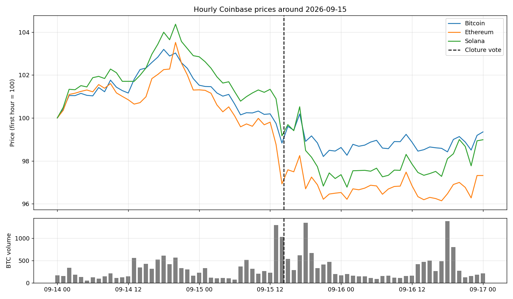

# Crypto Regulation Event Study: Chart Guide, Statistical Glossary, and Findings

**Project Hypothesis:** Crypto prices are more sensitive to regulatory announcements than to underlying economic and financial factors. *(Note: As detailed below, the empirical data do not support this hypothesis.)*

**Sample Period:** June 3, 2024 – November 17, 2026 (618 daily closing price observations; 617 daily return observations).

**Assets Tested:** Bitcoin (BTC), Ethereum (ETH), Solana (SOL), and Coinbase stock (COIN). Coinbase is analyzed as a "regulation-exposed" asset because its business model relies directly on U.S. regulatory compliance.

**Control Variables:** S&P 500 (broader equity market health), VIX (market volatility/fear gauge), and 10-year Treasury yield (benchmark interest rates).

---

## Executive Summary & Final Conclusion

**The data do not support the original hypothesis** that crypto prices are systematically more sensitive to regulatory announcements than to underlying economic and financial factors. Because only six events are tested, the empirical conclusion is "no statistically significant evidence for the hypothesis" rather than absolute proof of zero effect.

1. **Macro-Market Factors Dominate Daily Returns:** Traditional market benchmarks (specifically the S&P 500) are the primary driver of everyday crypto price movements ($p < 0.001$ across all assets), while legislative and regulatory event-day dummy variables add negligible explanatory power ($<0.15$ percentage points to signed-return $R^2$).
2. **Regulation Matters Selectively for "Regulation-Exposed" Assets:** Out of 48 abnormal-return tests (6 events $\times$ 4 assets $\times$ 2 windows), **only 2 results achieved statistical significance** ($|t| > 2.0$), both belonging to Coinbase around the GENIUS Act Senate vote (`+20.40%` with $t=3.01$ over $[-1, +1]$ and `+31.36%` with $t=3.27$ over $[0, +5]$). Coinbase also saw elevated volume (`1.51x–1.81x`) across all four congressional votes, proving equity investors price legislative milestones for centralized corporate intermediaries, while native cryptocurrencies show little to no statistically robust reaction.
3. **Broader Market Trends Overpower Policy Milestones:** The newest events (the OCC's final stablecoin rule on October 21, 2026, and the November 3, 2026 midterm elections) occurred entirely within a broader crypto-wide selloff. Market sentiment and general liquidity trends overshadow specific agency rulemaking or political events.

**Refined Thesis:** Regulatory news moves regulation-exposed corporate equities (Coinbase) around congressional votes, but traditional macro-market factors explain far more of daily crypto returns than legislation or agency rulemaking does.

---

## Events Tested (6)

- **GENIUS Act Senate Passage (2025-06-17):** Senate passes the Guiding and Establishing National Innovation for U.S. Stablecoins Act (68–30).
- **CLARITY Act House Passage (2025-07-17):** House passes market-structure legislation dividing SEC and CFTC jurisdiction (308–122).
- **GENIUS Act Signed into Law (2025-07-18):** Enacted as Public Law 119-27, creating the first comprehensive federal regulatory framework for payment stablecoins.
- **CLARITY Act Senate Cloture Failure (2026-09-15):** Senate fails to invoke cloture, stalling the market-structure bill.
- **GENIUS Act Implementing Rule — OCC Final Rule (2026-10-21):** The Office of the Comptroller of the Currency (OCC) issues its final rule (new `12 CFR Part 15`, OCC Bulletin 2026-50; effective January 18, 2027) establishing federal standards for permitted payment stablecoin issuers under OCC jurisdiction:
  - *Scope & Licensing:* Governs national banks, federal savings associations, federal branches, approved nonbank federal qualified issuers, foreign issuers, and transitioning state-qualified issuers (with a waiver process allowing existing U.S. issuers with pending applications to continue operating).
  - *Reserves & Redemption:* Mandates 1:1 backing in high-quality liquid assets (U.S. dollars, short-term U.S. Treasuries, or bank deposits), on-demand par redemption, segregated custody, and a 40% single-counterparty reserve cap (excluding U.S. government exposure and eligible custodians).
  - *Capital & Operational Backstop:* Requires at least $5 million in minimum capital plus a separate highly liquid "operational backstop" covering 12 months of total operating expenses.
  - *Yield & Interest Ban:* Implements the statutory prohibition on issuers (or agents acting on their behalf) paying interest or yield to holders solely for holding, using, or retaining a payment stablecoin, while dropping a proposed rebuttable presumption targeting affiliate arrangements.
- **Midterm Election Day (2026-11-03):** Included as a political benchmark to test whether crypto reacts to shifts in the U.S. political outlook for regulation.

---

## Statistical Glossary

- **CAR (Cumulative Abnormal Return):** Measures how much an asset's price moved *above and beyond* what normal macroeconomic conditions (S&P 500, VIX, and 10-year Treasury yields) predicted over a given event window.
- **t-stat (T-statistic):** Determines whether a CAR is statistically distinguishable from random market noise. In financial event studies, **$|t| > 2.0$** is required for statistical significance at the 5% level.
- **p-value:** The probability that an observed relationship occurred purely by chance. A value **$< 0.05$** indicates statistical reliability.
- **$R^2$ (R-squared):** The percentage of daily price variance explained by the regression model's independent variables.
- **Beta ($\beta$):** Measures sensitivity to the S&P 500. A $\beta$ of $2.81$ (observed for Coinbase) indicates that a $1\%$ move in the S&P 500 corresponds to an average $2.81\%$ move in Coinbase in the same direction.

---

## Sample Price Context (`prices.csv`)

Across the 618-trading-day sample, assets experienced wide macro cycles before finishing near multi-month or sample lows in November 2026:

| Asset | Sample Start (2024-06-03) | Sample Min (Date) | Sample Max (Date) | Sample End (2026-11-17) |
|---|---|---|---|---|
| **Bitcoin (BTC)** | $68,804.78 | $53,948.75 (2024-09-06) | $124,752.53 (2025-10-06) | $64,893.95 |
| **Ethereum (ETH)** | $3,766.39 | $1,472.55 (2025-04-08) | $4,831.35 (2025-08-22) | $1,822.96 |
| **Solana (SOL)** | $164.92 | $63.16 (2026-06-10) | $257.24 (2025-01-22) | $75.11 |
| **Coinbase (COIN)** | $231.39 | $115.02 (2026-11-17) | $419.78 (2025-07-18) | $115.02 |

**Daily Closing Prices on Event Dates (`prices.csv`):**

| Event Date | Event | Bitcoin (BTC) | Ethereum (ETH) | Solana (SOL) | Coinbase (COIN) |
|---|---|---|---|---|---|
| 2025-06-17 | GENIUS Senate passes | $104,601.12 | $2,510.76 | $147.75 | $253.85 |
| 2025-07-17 | CLARITY House passes | $119,289.84 | $3,476.78 | $175.79 | $410.75 |
| 2025-07-18 | GENIUS signed into law | $118,003.23 | $3,549.02 | $177.38 | $419.78 |
| 2026-09-15 | CLARITY Senate cloture fails | $75,612.51 | $2,399.09 | $96.89 | $172.11 |
| 2026-10-21 | GENIUS implementing rule (OCC Final Rule) | $84,011.97 | $2,470.77 | $106.79 | $177.08 |
| 2026-11-03 | Midterm election day | $77,345.05 | $2,272.73 | $92.92 | $145.45 |

---

## Chart-by-Chart Analysis

### Chart 1: Rebased Prices Around Each Event (`01_rebased_prices.png`)

- **What it displays:** Tracks asset price trajectories indexed to 100 on the trading day immediately preceding each event ($t = -1$), spanning $[-10, +10]$ trading days.
- **Key Takeaways:**
  - *GENIUS Senate Passage (top left):* Coinbase shares surged roughly 13% the next day and reached a 43% gain by day +6, while Bitcoin remained flat near 100. This is the cleanest isolated reaction in the study.
  - *CLARITY House & GENIUS Signing (top right, middle left):* Ethereum and Solana spiked 10%–17% around the window, and Coinbase reached its all-time sample closing high of **$419.78** on July 18, 2025. However, ETH and SOL were **already rallying sharply prior to day 0** (~30% in lead-up days), indicating pre-existing bull market momentum rather than a pure legislative shock.
  - *CLARITY Cloture Failure (middle right):* Assets dipped on day 0 but rallied 5%–16% over subsequent days, showing no lasting market damage.
  - *OCC Final Rule & Midterms (bottom row):* All four assets were already trending downward before the announcements and continued falling afterward (finishing 15%–20% below day -1 levels by day +10, with Coinbase hitting its sample low of **$115.02** on Nov 17). Because the OCC final rule's parameters were largely anticipated from its February 25, 2026 proposed rule, day 0 produced no structural break.

---

### Chart 2a: Abnormal Returns, $[-1, +1]$ Window (`02_CAR-1_+1.png`)

- **What it displays:** Isolates the 3-day abnormal return surrounding each event after stripping out S&P 500, VIX, and interest-rate movements.

| Event | Bitcoin | Ethereum | Solana | Coinbase |
|---|---|---|---|---|
| GENIUS Senate passes (2025-06-17) | -1.43% ($t=-0.32$) | -1.42% ($t=-0.19$) | -0.91% ($t=-0.10$) | **+20.40% ($t=3.01$)** |
| CLARITY House passes (2025-07-17) | -0.02% ($t=-0.00$) | +12.65% ($t=1.72$) | +7.90% ($t=0.92$) | +6.67% ($t=0.92$) |
| GENIUS signed into law (2025-07-18) | -1.15% ($t=-0.27$) | +11.55% ($t=1.58$) | +12.18% ($t=1.42$) | +3.05% ($t=0.42$) |
| CLARITY Senate cloture fails (2026-09-15) | -0.07% ($t=-0.02$) | -2.24% ($t=-0.41$) | -2.01% ($t=-0.36$) | -2.32% ($t=-0.36$) |
| GENIUS implementing rule (2026-10-21) | -0.36% ($t=-0.10$) | -0.64% ($t=-0.13$) | -0.80% ($t=-0.15$) | +0.67% ($t=0.09$) |
| Midterm election day (2026-11-03) | +2.40% ($t=0.65$) | +4.86% ($t=0.97$) | -3.91% ($t=-0.73$) | +2.46% ($t=0.34$) |

- **Key Takeaways:**
  - Only **Coinbase during the GENIUS Senate vote** clears the statistical significance threshold (`+20.40%`, $t = 3.01$).
  - On Oct 21 (OCC Final Rule), all four assets landed within `0.80%` of zero ($|t| \le 0.15$), confirming that agency rulemaking was already priced in.

---

### Chart 2b: Abnormal Returns, $[0, +5]$ Window (`02_CAR0_+5.png`)

- **What it displays:** Measures cumulative abnormal returns across the event day and subsequent five trading days.

| Event | Bitcoin | Ethereum | Solana | Coinbase |
|---|---|---|---|---|
| GENIUS Senate passes (2025-06-17) | -0.26% ($t=-0.04$) | -4.08% ($t=-0.39$) | -5.21% ($t=-0.42$) | **+31.36% ($t=3.27$)** |
| CLARITY House passes (2025-07-17) | -1.20% ($t=-0.20$) | +10.10% ($t=0.97$) | +5.28% ($t=0.43$) | -3.69% ($t=-0.36$) |
| GENIUS signed into law (2025-07-18) | -2.25% ($t=-0.38$) | +7.30% ($t=0.70$) | +6.10% ($t=0.50$) | -7.73% ($t=-0.76$) |
| CLARITY Senate cloture fails (2026-09-15) | +7.85% ($t=1.50$) | +5.86% ($t=0.76$) | +11.75% ($t=1.51$) | +2.52% ($t=0.27$) |
| GENIUS implementing rule (2026-10-21) | -2.61% ($t=-0.50$) | -4.70% ($t=-0.67$) | -5.44% ($t=-0.73$) | -5.24% ($t=-0.52$) |
| Midterm election day (2026-11-03) | -3.41% ($t=-0.65$) | -9.70% ($t=-1.36$) | -9.88% ($t=-1.31$) | -2.14% ($t=-0.21$) |

- **Key Takeaways:**
  - Coinbase's GENIUS Senate gain **persists and expands** (`+20.40%` $\to$ `+31.36%`, $t = 3.27$), while its July 2025 gains fully reversed over five days.
  - All four assets experienced uniformly negative 5-day CARs after the October and November 2026 events (largest $|t| = 1.36$), capturing a broader crypto-wide downtrend that the S&P 500 benchmark cannot filter out.

---

### Chart 3: Trading Volume Heatmap (`03_volume_heatmap.png`)

- **What it displays:** Compares event-window trading volume ($[0, +1]$) against the prior 30-day average (`1.00x` = normal baseline).

| Event | Bitcoin | Ethereum | Solana | Coinbase |
|---|---|---|---|---|
| GENIUS Senate passes (2025-06-17) | 0.72x | 0.66x | 0.70x | **1.78x** |
| CLARITY House passes (2025-07-17) | 0.94x | **1.70x** | 1.39x | **1.52x** |
| GENIUS signed into law (2025-07-18) | **1.57x** | **2.67x** | **2.50x** | **1.51x** |
| CLARITY Senate cloture fails (2026-09-15) | 0.86x | 0.97x | 0.80x | **1.81x** |
| GENIUS implementing rule (2026-10-21) | 0.78x | 0.68x | 0.53x | 0.72x |
| Midterm election day (2026-11-03) | 0.82x | 0.77x | 0.75x | 1.24x |

- **Key Takeaways:**
  - **Coinbase volume surged (`1.51x–1.81x`) on every congressional vote**, demonstrating active equity-investor attention to Capitol Hill.
  - However, **this pattern did not extend to agency rulemaking or elections** (Coinbase dropped to `0.72x` on Oct 21), and Bitcoin volume remained subdued across nearly all events.

---

### Chart 4: Rolling 20-Day Realized Volatility (`04_rolling_volatility.png`)

- **What it displays:** Annualized realized volatility over a rolling 20-day window (`vol_pre20` $\to$ `vol_post5`).

| Event | Bitcoin | Ethereum | Solana | Coinbase |
|---|---|---|---|---|
| GENIUS Senate passes | 36.7% $\to$ 26.9% (0.73x) | 61.8% $\to$ 38.0% (0.62x) | 58.2% $\to$ 45.6% (0.78x) | 51.5% $\to$ 121.5% (2.36x) |
| CLARITY House passes | 26.1% $\to$ 21.5% (0.82x) | 52.3% $\to$ 54.9% (1.05x) | 55.1% $\to$ 105.6% (1.92x) | 79.7% $\to$ 39.1% (0.49x) |
| GENIUS signed into law | 24.2% $\to$ 21.2% (0.87x) | 51.7% $\to$ 53.5% (1.04x) | 54.1% $\to$ 112.7% (2.08x) | 77.5% $\to$ 27.9% (0.36x) |
| CLARITY cloture fails | 46.2% $\to$ 66.3% (1.43x) | 68.8% $\to$ 72.9% (1.06x) | 62.4% $\to$ 91.9% (1.47x) | 86.2% $\to$ 136.0% (1.58x) |
| GENIUS implementing rule | 20.4% $\to$ 29.5% (1.44x) | 29.6% $\to$ 34.1% (1.15x) | 38.1% $\to$ 24.4% (0.64x) | 48.9% $\to$ 53.1% (1.09x) |
| Midterm election day | 26.2% $\to$ 55.1% (2.10x) | 34.2% $\to$ 88.3% (2.58x) | 40.3% $\to$ 64.4% (1.60x) | 63.6% $\to$ 98.0% (1.54x) |

- **Key Takeaways:**
  - Volatility **did not spike uniformly** around regulatory milestones. The largest turbulence spikes in the dataset (early 2026, where ETH and SOL exceeded 100% annualized volatility) had zero alignment with regulatory dates.
  - Post-November 3 volatility increases (`1.54x–2.58x`) started from multi-month lows and coincided with the broader market selloff.

---

### Chart 5: Intraday Prices on September 14–16, 2026 (`05_intraday_sept15.png`)

- **What it displays:** Hourly high-frequency pricing and Bitcoin volume around the failed Senate cloture vote for the CLARITY Act.
- **Key Takeaways:**
  - At the exact hour of the cloture failure, prices dropped sharply (**BTC -1.4%, SOL -2.0%, ETH -2.8%**) alongside a spike in Bitcoin volume (~1,300 BTC vs. 100–500 baseline).
  - Because this drop reversed within days (see Chart 2b), it demonstrates that high-frequency data captures short-term sentiment shocks that daily closing prices wash out.

---

### Chart 6: Variance Explained ($R^2$ Decomposition) (`06_r2_decomposition.png`)

- **What it displays:** Compares explanatory power ($R^2$) across $n = 617$ trading days between macroeconomic controls alone versus adding event-day dummy variables.

**Signed Daily Returns (`dependent = return`, $n = 617$):**

| Asset | Macro $R^2$ Only | $R^2$ With Events | $R^2$ Gain | Event Coef | Event p-value | S&P 500 Beta ($\beta$) | S&P p-value | $\Delta$VIX p-value | $\Delta$Rate p-value |
|---|---|---|---|---|---|---|---|---|---|
| **Bitcoin** | 19.68% | 19.68% | +0.004 pp | -0.0014 | 0.727 | 0.99 | <0.001 (`9.9e-5`) | 0.341 | 0.156 |
| **Ethereum** | 22.35% | 22.49% | +0.144 pp | +0.0120 | 0.102 | 1.45 | <0.001 (`7.1e-5`) | 0.198 | 0.734 |
| **Solana** | 17.41% | 17.47% | +0.054 pp | +0.0081 | 0.450 | 1.42 | <0.001 (`1.1e-4`) | 0.208 | 0.464 |
| **Coinbase** | 30.83% | 30.95% | +0.116 pp | +0.0123 | 0.481 | 2.81 | <0.001 (`1.4e-19`) | 0.421 | 0.174 |

**Absolute Daily Returns / Move Sizes (`dependent = abs_return`, $n = 617$):**

| Asset | Macro $R^2$ Only | $R^2$ With Events | $R^2$ Gain | Event Coef | Event p-value | S&P Abs Coef | S&P p-value | $\Delta$VIX p-value | $\Delta$Rate p-value |
|---|---|---|---|---|---|---|---|---|---|
| **Bitcoin** | 2.29% | 2.35% | +0.064 pp | -0.0038 | 0.359 | 0.43 | 0.076 | 0.047 | 0.810 |
| **Ethereum** | 2.34% | 2.35% | +0.004 pp | -0.0015 | 0.824 | 0.74 | 0.041 | 0.051 | 0.884 |
| **Solana** | 1.14% | 1.26% | +0.114 pp | -0.0077 | 0.347 | 0.43 | 0.248 | 0.184 | 0.517 |
| **Coinbase** | 1.06% | 1.58% | +0.518 pp | +0.0175 | 0.148 | 0.08 | 0.808 | 0.106 | 0.859 |

- **Key Takeaways:**
  - Broad macroeconomic factors explain **$17.41\%$ to $30.83\%$** of daily signed returns, anchored by highly significant S&P 500 betas ($p < 0.001$).
  - Regulatory event dummies add virtually zero explanatory power (**`+0.004` to `+0.144` percentage points** for signed returns) and are statistically insignificant across all specifications.

---

## Methodological Limitations

1. **Small Sample Size:** Only 6 events (12 event-day observations across 617 trading days), resulting in limited statistical power.
2. **Clustered Events:** July 17 and 18, 2025 are separated by one trading day; October 21 and November 3, 2026 are nine trading days apart, causing overlapping estimation windows.
3. **Heterogeneous Event Types:** Pooling legislative votes with an agency final rule (`12 CFR Part 15`, largely priced in after the Feb 25, 2026 proposed rule) and a general midterm election dilutes the event-dummy specification.
4. **Pre-Existing Trends & Benchmark Noise:** The S&P 500 market model explains $12.3\%$–$41.8\%$ of estimation-window variance and cannot absorb crypto-sector-wide bull/bear trends (such as the July 2025 rally or Oct–Nov 2026 selloff).

---

## Repository Structure

| File Path | Description |
|---|---|
| `fintech_python.py` / `crypto_event_study.py` | Main Python script fetching market/macro data, running regressions, and generating figures |
| `output/01_rebased_prices.png` | Indexed price reaction curves ($[-10, +10]$ days) |
| `output/02_CAR-1_+1.png`, `output/02_CAR0_+5.png` | Cumulative abnormal return bar charts with confidence intervals |
| `output/03_volume_heatmap.png` | Event-window volume ratio heatmap vs. 30-day baseline |
| `output/04_rolling_volatility.png` | Rolling 20-day annualized volatility with event markers |
| `output/05_intraday_sept15.png` | Hourly price and Bitcoin volume chart around Sept 15, 2026 cloture vote |
| `output/06_r2_decomposition.png` | Macro vs. regulatory event $R^2$ comparison |
| `output/event_study_results.csv` | Event-level CARs, t-stats, volume ratios, and pre/post volatility (24 asset-event pairs) |
| `output/regression_results.csv` | Full-sample macro and event-dummy regression outputs ($n = 617$) |
| `output/prices.csv` | Raw daily closing prices (618 trading days, June 3, 2024 – November 17, 2026) |
