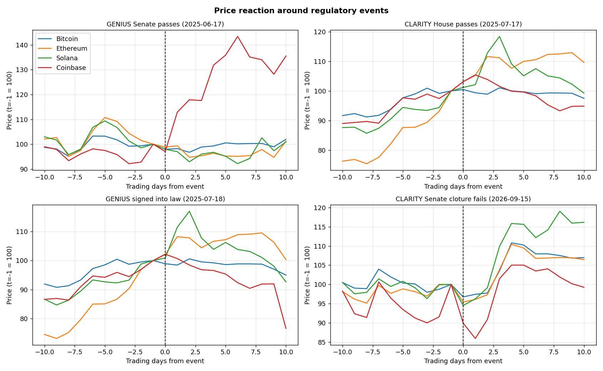
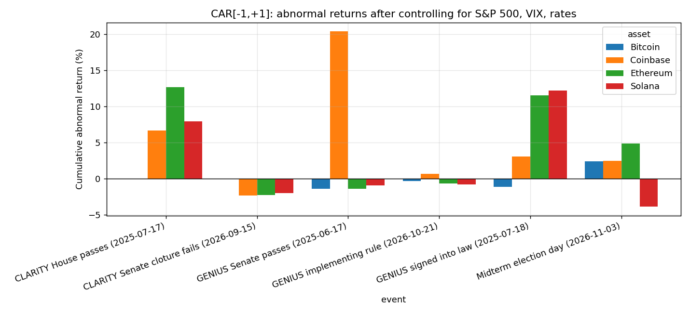
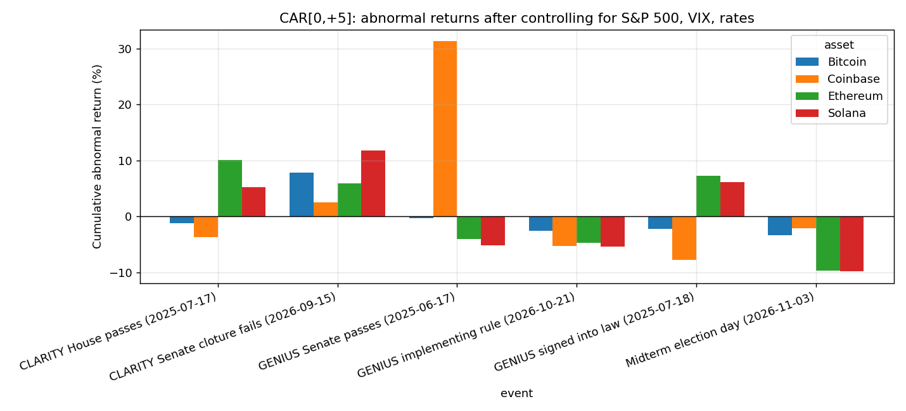
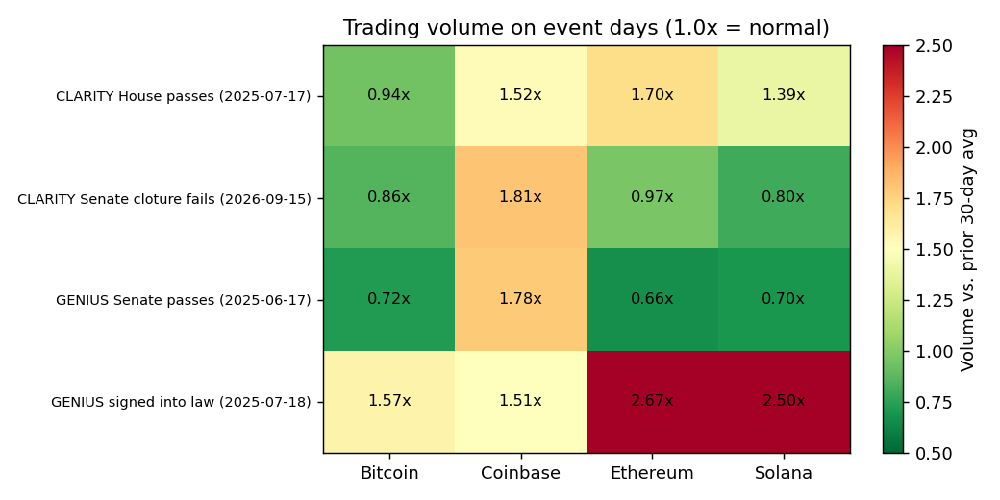
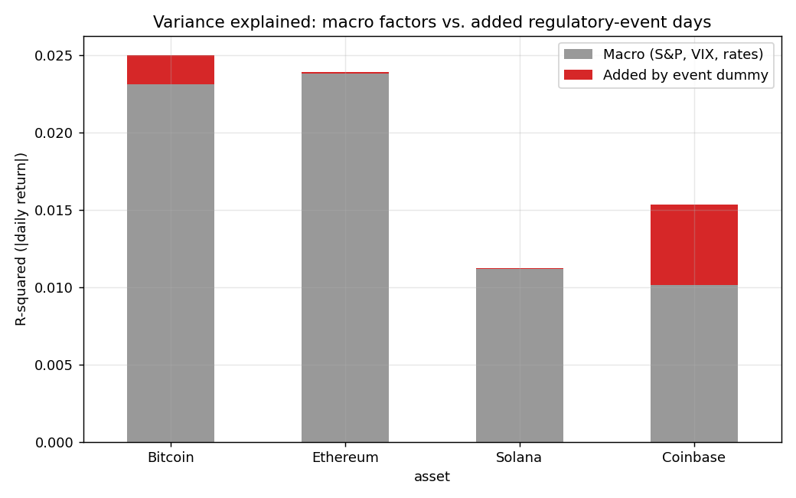

# Crypto Regulation Event Study: Chart Guide, Statistical Glossary, and Findings

**Project hypothesis:** Crypto prices are more sensitive to regulatory announcements than to underlying economic and financial factors. *(Note: As detailed below, the data do not support this hypothesis.)*

**Sample period:** June 3, 2024 – November 17, 2026 (618 daily closing price observations; 617 daily return observations).

**Events tested (6):**
- **GENIUS Act Senate passage (2025-06-17):** Senate passes the Guiding and Establishing National Innovation for U.S. Stablecoins Act (68–30).
- **CLARITY Act House passage (2025-07-17):** House passes market-structure legislation dividing SEC and CFTC jurisdiction (308–122).
- **GENIUS Act signed into law (2025-07-18):** Enacted as Public Law 119-27, creating the first comprehensive federal regulatory framework for payment stablecoins.
- **CLARITY Act Senate cloture failure (2026-09-15):** Senate fails to invoke cloture, stalling the market-structure bill.
- **GENIUS Act implementing rule — OCC Final Rule (2026-10-21):** The Office of the Comptroller of the Currency (OCC) issues its final rule (new `12 CFR Part 15`, OCC Bulletin 2026-50; effective January 18, 2027) establishing federal standards for permitted payment stablecoin issuers under OCC jurisdiction. Key provisions include:
  - *Scope & Licensing:* Governs national banks, federal savings associations, federal branches, approved nonbank federal qualified issuers, foreign issuers, and transitioning state-qualified issuers (with a waiver process allowing existing U.S. issuers with pending applications to continue operating).
  - *Reserves & Redemption:* Mandates 1:1 backing in high-quality liquid assets (such as U.S. dollars, short-term U.S. Treasuries, or bank deposits), on-demand par redemption, segregated custody, and a 40% single-counterparty reserve cap (excluding U.S. government exposure and eligible custodians).
  - *Capital & Operational Backstop:* Requires at least $5 million in minimum capital plus a separate highly liquid "operational backstop" covering 12 months of total operating expenses.
  - *Yield & Interest Ban:* Implements the statutory prohibition on issuers (or agents acting on their behalf) paying interest or yield to holders solely for holding, using, or retaining a payment stablecoin, while dropping a proposed rebuttable presumption targeting affiliate arrangements.
- **Midterm election day (2026-11-03):** A political event rather than a regulatory announcement, included to test whether crypto reacts to the U.S. political outlook for regulation.

**Assets tested:** Bitcoin (BTC), Ethereum (ETH), Solana (SOL), and Coinbase stock (COIN). Coinbase is analyzed as a "regulation-exposed" asset because its entire business model relies on U.S. compliance.

**Control variables:** S&P 500 (broader stock market health), VIX (market fear gauge), and 10-year Treasury yield (benchmark interest rates).

---

## Statistical Glossary: How to Read the Metrics

Before reviewing the findings, it is essential to understand the statistical terms used throughout this project:

- **CAR (Cumulative Abnormal Return):** The core measurement of the study. It calculates how much an asset's price went up or down *above and beyond* what normal economic conditions (the S&P 500, interest rates, and market fear) would have predicted.
- **t-stat (T-statistic):** A statistical metric used to determine whether a result is real or just random chance. In financial studies, **a t-stat must be roughly above 2 or below -2** in absolute value to be considered "statistically significant." If it is below 2, the price movement cannot be distinguished from normal market noise.
- **p-value:** The probability that a result happened purely by chance. A standard threshold is $0.05$ (or $5\%$). A p-value *below* $0.05$ indicates a reliable, statistically meaningful result. A p-value *above* $0.05$ means we cannot trust that the event caused the price shift.
- **$R^2$ (R-squared):** A percentage score showing how much of an asset's price movement can be explained by a specific group of factors. For example, if macro factors have an $R^2$ of $20\%$, it means traditional markets explain $20\%$ of that asset's day-to-day movement.
- **Beta ($\beta$):** A measure of how aggressively an asset moves relative to a benchmark (the S&P 500). A beta of $1.0$ means the asset moves in lockstep with the S&P 500. A beta of $2.81$ (observed for Coinbase) means that when the S&P 500 moves $1\%$, Coinbase typically moves $2.81\%$ in the same direction.

---

## Bottom Line (Read This First)

**The data do not support the original hypothesis.** With only six events the test has limited power, so the honest wording is "no evidence for it," not "proof it is false."

- Out of 48 abnormal-return tests (6 events $\times$ 4 assets $\times$ 2 time windows), **only 2 results were statistically significant**, both belonging to Coinbase around the GENIUS Senate vote (`+20.40%` with $t=3.01$ over $[-1, +1]$ and `+31.36%` with $t=3.27$ over $[0, +5]$). At the 5% level, about 2 false positives are expected across 48 tests, so 2 hits is roughly what chance alone would produce. Coinbase's t-stats above 3 are strong enough to report, but treat them as one isolated finding.
- **None of the 16 new tests (Oct 21 OCC final rule and Nov 3 midterms) is significant.** The largest, SOL (`-9.88%`, $t=-1.31$) and ETH (`-9.70%`, $t=-1.36$) over $[0, +5]$ after the midterms, fall well short of significance.
- **Bitcoin shows no meaningful reaction** to any of the legislative or rulemaking events.
- **Day-to-day crypto returns are driven by the stock market**, not government regulation. The S&P 500 beta is highly significant ($p < 0.001$) for every asset, while regulatory event-day variables add less than $0.15$ percentage points to signed-return $R^2$.
- **The two newest events occur during a broad crypto selloff.** All four assets were falling before and after Oct 21 and Nov 3 with no visible break on the event day. The market trend, not the event, is the dominant story.
- There is a **fast, short-lived intraday reaction on September 15, 2026**, along with **Coinbase-specific volume and price reactions around congressional votes**, which form the genuine empirical findings of this paper.

**Refined Thesis for the Paper:** Regulatory news matters for regulation-exposed assets (Coinbase, and to a lesser extent Ethereum and Solana) but has no clear impact on crypto as a whole. Traditional macro-market factors explain far more of daily crypto returns than legislation or agency rulemaking does.

---

## Sample Price Context (`prices.csv`)

Across the full 618-trading-day sample (June 3, 2024 to November 17, 2026), assets experienced wide macro cycles before finishing near multi-month or sample lows in November 2026:

| Asset | Sample Start (2024-06-03) | Sample Min (Date) | Sample Max (Date) | Sample End (2026-11-17) |
|---|---|---|---|---|
| Bitcoin (BTC) | $68,804.78 | $53,948.75 (2024-09-06) | $124,752.53 (2025-10-06) | $64,893.95 |
| Ethereum (ETH) | $3,766.39 | $1,472.55 (2025-04-08) | $4,831.35 (2025-08-22) | $1,822.96 |
| Solana (SOL) | $164.92 | $63.16 (2026-06-10) | $257.24 (2025-01-22) | $75.11 |
| Coinbase (COIN) | $231.39 | $115.02 (2026-11-17) | $419.78 (2025-07-18) | $115.02 |

**Daily Closing Prices on Event Dates (`prices.csv`):**

| Event Date | Event | Bitcoin (BTC) | Ethereum (ETH) | Solana (SOL) | Coinbase (COIN) |
|---|---|---|---|---|---|
| 2025-06-17 | GENIUS Senate passes | $104,601.12 | $2,510.76 | $147.75 | $253.85 |
| 2025-07-17 | CLARITY House passes | $119,289.84 | $3,476.78 | $175.79 | $410.75 |
| 2025-07-18 | GENIUS signed into law | $118,003.23 | $3,549.02 | $177.38 | $419.78 |
| 2026-09-15 | CLARITY Senate cloture fails | $75,612.51 | $2,399.09 | $96.89 | $172.11 |
| 2026-10-21 | GENIUS implementing rule (OCC Final Rule) | $84,011.97 | $2,470.77 | $106.79 | $177.08 |
| 2026-11-03 | Midterm election day | $77,345.05 | $2,272.73 | $92.92 | $145.45 |

---

## Chart 1: Rebased Prices Around Each Event

**What it shows:** Tracks each asset's price indexed to 100 on the day immediately preceding an event, spanning 10 trading days before and after. The grid is read left to right: row 1 is GENIUS Senate and CLARITY House, row 2 is GENIUS signed and cloture fails, row 3 is the Oct 21 OCC final rule and the midterms.

**What it tells us:**
- **GENIUS Senate passes (top left):** Coinbase shares surged roughly 13% the next day and reached a 43% gain by day +6, while Bitcoin remained completely flat near 100. This is the cleanest event reaction in the entire dataset and is unique to Coinbase.
- **CLARITY House passes and GENIUS signed (top right, middle left):** Ethereum and Solana prices spiked 10% to 17% around the event window, and Coinbase reached its all-time sample closing high of **$419.78** on July 18, 2025. However, the chart reveals ETH and SOL were **already rallying sharply prior to the news** (Ethereum rose ~30% in the days leading up to day 0). This makes it impossible to prove the law caused the rally rather than a pre-existing bull market trend.
- **CLARITY cloture fails (middle right):** All assets dipped initially on day 0, but subsequently rallied 5% to 16% over the following days. The failure of the bill did not cause a permanent market collapse.
- **GENIUS implementing rule — OCC Final Rule (bottom left):** All four assets were already drifting down before the OCC finalized `12 CFR Part 15`, show no reaction on day 0, and keep falling afterward (roughly 7% to 19% below the day -1 level by day +8, with a partial rebound by day +10). There is no visible break at the event date, likely because the rule's core parameters were already anticipated from the OCC's February 25, 2026 proposed rulemaking and the statute itself.
- **Midterm election day (bottom right):** A steady decline begins well before the election (Coinbase falls from ~124 to 100 between day -9 and day -1). There is a brief bounce on day +1 (BTC ~105, COIN ~110), then the slide resumes, with all assets about 15% to 20% below the day -1 level by day +10 (Coinbase ultimately hits its sample low of **$115.02** on Nov 17).
- **Bitcoin stays flat around day 0 in the three 2025 events.** In the Oct and Nov 2026 panels it falls together with the other assets, which points to a crypto-wide trend rather than an event-specific effect.

---

## Chart 2a: Abnormal Returns, $[-1, +1]$ Window (`event_study_results.csv`)

**What it shows:** Isolates the "regulation effect" by removing what the S&P 500, VIX, and interest-rate changes would have predicted over a 3-day window surrounding each event.

| Event | Bitcoin | Ethereum | Solana | Coinbase |
|---|---|---|---|---|
| GENIUS Senate passes (2025-06-17) | -1.43% ($t=-0.32$) | -1.42% ($t=-0.19$) | -0.91% ($t=-0.10$) | **+20.40% ($t=3.01$)** |
| CLARITY House passes (2025-07-17) | -0.02% ($t=-0.00$) | +12.65% ($t=1.72$) | +7.90% ($t=0.92$) | +6.67% ($t=0.92$) |
| GENIUS signed into law (2025-07-18) | -1.15% ($t=-0.27$) | +11.55% ($t=1.58$) | +12.18% ($t=1.42$) | +3.05% ($t=0.42$) |
| CLARITY Senate cloture fails (2026-09-15) | -0.07% ($t=-0.02$) | -2.24% ($t=-0.41$) | -2.01% ($t=-0.36$) | -2.32% ($t=-0.36$) |
| GENIUS implementing rule (2026-10-21) | -0.36% ($t=-0.10$) | -0.64% ($t=-0.13$) | -0.80% ($t=-0.15$) | +0.67% ($t=0.09$) |
| Midterm election day (2026-11-03) | +2.40% ($t=0.65$) | +4.86% ($t=0.97$) | -3.91% ($t=-0.73$) | +2.46% ($t=0.34$) |

**What it tells us:**
- Only **Coinbase during the GENIUS Senate passage** reaches statistical significance (highlighted in bold, `+20.40%`, $t = 3.01$). No other event-asset pair has $|t|$ above `1.72`.
- Although Ethereum and Solana show positive CARs (`+7.90%` to `+12.65%`) around the CLARITY House vote and GENIUS signing, their t-stats range between `0.92` and `1.72`, falling short of the required threshold of `2.0`. These results are suggestive indications, not proven facts.
- **Oct 21 (OCC Final Rule):** All four assets land within `0.80%` of zero ($|t| \le 0.15$). Even for Coinbase—which derives substantial revenue from stablecoin distribution—the finalization of `12 CFR Part 15` (including the yield ban without an affiliate presumption and the waiver path for existing issuers) produced virtually zero abnormal movement (`+0.67%`, $t=0.09$).
- **Midterms:** The direction is mixed (BTC `+2.40%`, ETH `+4.86%`, COIN `+2.46%` up; SOL `-3.91%` down), with no consistent pattern across assets and no t-stat above `0.97`.
- Directionally, the first four events align with intuition (pro-regulation news yields positive moves for altcoins/COIN, while failure yields negative initial moves), but the statistical evidence remains weak overall.

---

## Chart 2b: Abnormal Returns, $[0, +5]$ Window (`event_study_results.csv`)

**What it shows:** Measures cumulative abnormal returns accumulated over the event day and the subsequent five trading days.

| Event | Bitcoin | Ethereum | Solana | Coinbase |
|---|---|---|---|---|
| GENIUS Senate passes (2025-06-17) | -0.26% ($t=-0.04$) | -4.08% ($t=-0.39$) | -5.21% ($t=-0.42$) | **+31.36% ($t=3.27$)** |
| CLARITY House passes (2025-07-17) | -1.20% ($t=-0.20$) | +10.10% ($t=0.97$) | +5.28% ($t=0.43$) | -3.69% ($t=-0.36$) |
| GENIUS signed into law (2025-07-18) | -2.25% ($t=-0.38$) | +7.30% ($t=0.70$) | +6.10% ($t=0.50$) | -7.73% ($t=-0.76$) |
| CLARITY Senate cloture fails (2026-09-15) | +7.85% ($t=1.50$) | +5.86% ($t=0.76$) | +11.75% ($t=1.51$) | +2.52% ($t=0.27$) |
| GENIUS implementing rule (2026-10-21) | -2.61% ($t=-0.50$) | -4.70% ($t=-0.67$) | -5.44% ($t=-0.73$) | -5.24% ($t=-0.52$) |
| Midterm election day (2026-11-03) | -3.41% ($t=-0.65$) | -9.70% ($t=-1.36$) | -9.88% ($t=-1.31$) | -2.14% ($t=-0.21$) |

**What it tells us:**
- Coinbase's reaction to the GENIUS Act **persists and expands** (`+20.40%` to `+31.36%`, $t = 3.27$), confirming it was not a fleeting one-day blip.
- For the July 2025 events, Coinbase's initial gains completely reversed (`+6.67%` turned into `-3.69%` after CLARITY House, and `+3.05%` turned into `-7.73%` after GENIUS signing), pointing toward an initial overreaction that faded.
- Surprisingly, the **cloture failure was followed by a positive 5-day abnormal return** across all assets (`+2.52%` to `+11.75%`). This runs counter to the expectation that regulatory failure damages crypto, likely representing market relief that stricter rules were avoided or an unrelated market rebound.
- **After both new events, all four assets show negative 5-day abnormal returns** (none statistically significant, largest $|t| = 1.36$ for ETH at `-9.70%` and $|t| = 1.31$ for SOL at `-9.88%`). The sign flips from the cloture event, where all four were positive. Finalizing the OCC's stablecoin framework is not clearly bad news for crypto, yet all four assets fell afterward (`-2.61%` to `-5.44%`). This suggests the abnormal returns are picking up a **crypto-wide trend** (a rebound in September, a selloff in Oct to Nov) that the S&P 500-based model cannot remove, rather than a response to the OCC rule itself.

---

## Chart 3: Trading Volume Heatmap (`event_study_results.csv`)

**What it shows:** Compares event-day and post-event (`[0, +1]`) trading volume against the prior 30-day average. A score of `1.00x` represents normal baseline activity; green indicates below-normal volume, and red indicates an active surge.

**Event-Window Volume Ratios (`vol_ratio[0,+1]`):**

| Event | Bitcoin | Ethereum | Solana | Coinbase |
|---|---|---|---|---|
| GENIUS Senate passes (2025-06-17) | 0.72x | 0.66x | 0.70x | **1.78x** |
| CLARITY House passes (2025-07-17) | 0.94x | **1.70x** | 1.39x | **1.52x** |
| GENIUS signed into law (2025-07-18) | **1.57x** | **2.67x** | **2.50x** | **1.51x** |
| CLARITY Senate cloture fails (2026-09-15) | 0.86x | 0.97x | 0.80x | **1.81x** |
| GENIUS implementing rule (2026-10-21) | 0.78x | 0.68x | 0.53x | 0.72x |
| Midterm election day (2026-11-03) | 0.82x | 0.77x | 0.75x | 1.24x |

**What it tells us:**
- **Coinbase volume was elevated (`1.51x` to `1.81x` normal) on all four congressional-vote events**, suggesting COIN investors watch legislative action closely.
- **That pattern does not extend to the new events.** Coinbase volume was below normal on Oct 21 (`0.72x`) when the OCC issued its final rule, and only modestly elevated on election day (`1.24x`). In this small sample, votes in Congress move Coinbase volume, but agency rulemaking and elections do not.
- **Ethereum and Solana volume surged** (`2.67x` and `2.50x` normal, respectively) during the GENIUS Act signing, representing the strongest volume response in the dataset.
- **Oct 21 volume was below normal for every asset** (`0.53x` to `0.78x`), the quietest event in the study. Midterm volume was also below normal for BTC (`0.82x`), ETH (`0.77x`), and SOL (`0.75x`).
- **Bitcoin trading volume stayed mostly normal** (`0.72x` to `1.57x`), reinforcing the conclusion that everyday Bitcoin traders do not alter behavior based on Washington politics or agency rulemaking.

---

## Chart 4: Rolling 20-Day Volatility (`event_study_results.csv`)

**What it shows:** Measures annualized price turbulence (risk/volatility) over a rolling 20-day window from mid-2024 through late 2026, with dashed lines marking the regulatory events. The two new lines (Oct 21 and Nov 3) sit at the right edge.

**Pre-Event 20-Day vs. Post-Event 5-Day Annualized Volatility (`vol_pre20` $\to$ `vol_post5`, Ratio `vol_change`):**

| Event | Bitcoin | Ethereum | Solana | Coinbase |
|---|---|---|---|---|
| GENIUS Senate passes | 36.7% $\to$ 26.9% (0.73x) | 61.8% $\to$ 38.0% (0.62x) | 58.2% $\to$ 45.6% (0.78x) | 51.5% $\to$ 121.5% (2.36x) |
| CLARITY House passes | 26.1% $\to$ 21.5% (0.82x) | 52.3% $\to$ 54.9% (1.05x) | 55.1% $\to$ 105.6% (1.92x) | 79.7% $\to$ 39.1% (0.49x) |
| GENIUS signed into law | 24.2% $\to$ 21.2% (0.87x) | 51.7% $\to$ 53.5% (1.04x) | 54.1% $\to$ 112.7% (2.08x) | 77.5% $\to$ 27.9% (0.36x) |
| CLARITY cloture fails | 46.2% $\to$ 66.3% (1.43x) | 68.8% $\to$ 72.9% (1.06x) | 62.4% $\to$ 91.9% (1.47x) | 86.2% $\to$ 136.0% (1.58x) |
| GENIUS implementing rule | 20.4% $\to$ 29.5% (1.44x) | 29.6% $\to$ 34.1% (1.15x) | 38.1% $\to$ 24.4% (0.64x) | 48.9% $\to$ 53.1% (1.09x) |
| Midterm election day | 26.2% $\to$ 55.1% (2.10x) | 34.2% $\to$ 88.3% (2.58x) | 40.3% $\to$ 64.4% (1.60x) | 63.6% $\to$ 98.0% (1.54x) |

**What it tells us:**
- Volatility **did not spike uniformly around the regulatory dates through Oct 21.** The mid-2025 event cluster occurred during a remarkably calm market period for Bitcoin (pre-event 20-day volatility hovered at `24.2%–26.1%`), and Bitcoin hit its lowest pre-event volatility in the dataset (`20.4%`) right before the Oct 21 OCC final rule. (Notable asset-specific spikes include Coinbase jumping from `51.5%` to `121.5%` (`2.36x`) after the GENIUS Senate vote, and Solana jumping from `54.1%` to `112.7%` (`2.08x`) in July 2025.)
- The **largest volatility spikes** (such as early 2026, where SOL and ETH exceeded `100%` annualized volatility) **have zero alignment with any regulatory event.** Macroeconomic shocks entirely dwarf legislative and agency milestones.
- **After Nov 3, realized volatility rises sharply** across all four assets in the 5-day post-event window: BTC jumps `26.2%` $\to$ `55.1%` (`2.10x`), ETH `34.2%` $\to$ `88.3%` (`2.58x`), SOL `40.3%` $\to$ `64.4%` (`1.60x`), and COIN `63.6%` $\to$ `98.0%` (`1.54x`). Treat this with caution: it starts from near-record lows, only about half of each rolling 20-day chart window is post-event, and it coincides with the broad selloff in Chart 1, so it cannot be attributed to the election.

---

## Chart 5: Hourly Prices on September 14 to 16, 2026

**What it shows:** Zooms in from daily data to an **hourly** frequency around the failed Senate cloture vote, tracking prices and hourly Bitcoin trading volume.

**What it tells us:**
- Around the exact hour of the vote, prices dropped sharply (**BTC -1.4%, SOL -2.0%, ETH -2.8%**), and Bitcoin trading volume spiked to ~1,300 BTC compared to a typical baseline of 100 to 500 BTC.
- This is the **cleanest intraday evidence of a regulatory reaction** in the project, demonstrating that high-frequency data captures immediate shocks that daily closing prices wash out.
- *Caveat:* Prices were already softening prior to the vote timestamp, and the decline reversed within days (see Chart 2b), which is consistent with a short-term sentiment reaction.

---

## Chart 6: Variance Explained ($R^2$ Decomposition, `regression_results.csv`)

**What it shows:** Breaks down how much of daily returns and daily move sizes are explained by traditional macroeconomic controls (S&P 500, VIX changes, 10-year Treasury yield changes) versus adding event-day dummy variables across $n = 617$ trading days. With six events, the event dummy covers 12 event-day observations.

**Signed Daily Returns (`dependent = return`, $n = 617$):**

| Asset | Macro $R^2$ only | $R^2$ with events | $R^2$ gain | Event coef | Event p-value | S&P 500 Beta ($\beta$) | S&P p-value | $\Delta$VIX p-value | $\Delta$Rate p-value |
|---|---|---|---|---|---|---|---|---|---|
| Bitcoin | 19.68% | 19.68% | +0.004 pp | -0.0014 | 0.727 | 0.99 | <0.001 (`9.9e-5`) | 0.341 | 0.156 |
| Ethereum | 22.35% | 22.49% | +0.144 pp | +0.0120 | 0.102 | 1.45 | <0.001 (`7.1e-5`) | 0.198 | 0.734 |
| Solana | 17.41% | 17.47% | +0.054 pp | +0.0081 | 0.450 | 1.42 | <0.001 (`1.1e-4`) | 0.208 | 0.464 |
| Coinbase | 30.83% | 30.95% | +0.116 pp | +0.0123 | 0.481 | 2.81 | <0.001 (`1.4e-19`) | 0.421 | 0.174 |

**Absolute Daily Returns / Size of Moves (`dependent = abs_return`, $n = 617$):**

| Asset | Macro $R^2$ only | $R^2$ with events | $R^2$ gain | Event coef | Event p-value | S&P abs coef | S&P p-value | $\Delta$VIX p-value | $\Delta$Rate p-value |
|---|---|---|---|---|---|---|---|---|---|
| Bitcoin | 2.29% | 2.35% | +0.064 pp | -0.0038 | 0.359 | 0.43 | 0.076 | 0.047 | 0.810 |
| Ethereum | 2.34% | 2.35% | +0.004 pp | -0.0015 | 0.824 | 0.74 | 0.041 | 0.051 | 0.884 |
| Solana | 1.14% | 1.26% | +0.114 pp | -0.0077 | 0.347 | 0.43 | 0.248 | 0.184 | 0.517 |
| Coinbase | 1.06% | 1.58% | +0.518 pp | +0.0175 | 0.148 | 0.08 | 0.808 | 0.106 | 0.859 |

**What it tells us:**
- Broad macroeconomic factors explain **$17.41\%$ to $30.83\%$** of daily signed crypto returns, anchored by highly significant S&P 500 betas ($p < 0.001$ across all four assets; Coinbase $\beta = 2.81$ with $p = 1.43 \times 10^{-19}$). By contrast, $\Delta\text{VIX}$ and $\Delta\text{Rate}$ are not statistically significant in the signed-return regressions ($p > 0.15$ for all assets).
- Regulatory event dummies add virtually zero explanatory power: between **`+0.004` pp (BTC) and `+0.144` pp (ETH)** for signed returns, and no event coefficient is significant in either specification. Traditional stock market trends dictate daily crypto returns far more than legislative or rulemaking news.
- **Bitcoin's earlier "significant" result was fragile.** With four events, its event coefficient on absolute returns had $p = 0.046$ (negative, meaning smaller moves on event days). With six events it is $p = 0.359$. Do not cite the earlier result.
- For move sizes (`abs_return`), Coinbase has the largest $R^2$ gain (`+0.518` pp) and lowest event p-value (`0.148`) of the four, which fits it being the one regulation-exposed asset, but it remains statistically insignificant.

---

## Summary of Findings

| Research Question | Evidence Source | Final Verdict |
|---|---|---|
| Do crypto prices move more on regulatory news than macro factors? | Charts 2 & 6, `regression_results.csv` | **No.** S&P 500 beta is highly significant ($p < 0.001$); event dummies add $< 0.15$ pp to signed $R^2$ and are insignificant. |
| Does regulation move any specific asset? | Charts 1, 2a, 2b, 3, `event_study_results.csv` | **Coinbase yes** (`+20.40%` / `+31.36%` on GENIUS Senate, and `1.51x–1.81x` volume around congressional votes), though only one event drives it; ETH/SOL directionally yes (`+7.90%` to `+12.65%` in July 2025) but insignificant; **Bitcoin no.** |
| Does regulation increase market volatility? | Chart 4, `event_study_results.csv` | **No consistent effect.** The post-Nov 3 rise (`1.54x–2.58x` pre-event vol) coincides with a broad selloff and cannot be attributed to the election. |
| Is there a fast reaction at all? | Chart 5 | **Yes, intraday on Sept 15, 2026** (BTC `-1.4%`, ETH `-2.8%`, SOL `-2.0%`), though it quickly reversed. |
| Do trading volumes respond? | Chart 3, `event_study_results.csv` | **Coinbase around congressional votes only (`1.51x–1.81x`); ETH/SOL on GENIUS signing (`2.67x`/`2.50x`); Bitcoin mostly no.** The Oct 21 OCC rule (`0.53x–0.78x`) and election day drew no volume surge. |
| Do rule implementation and political events matter? | Charts 1, 2b, 3, `prices.csv` | **No clear effect.** Both the OCC's final GENIUS Act rule (`12 CFR Part 15`) and the midterms occurred inside a crypto-wide downtrend that took COIN to its sample low (`$115.02`). |

## Limitations to State in the Paper
1. **Small sample size:** Only 6 events and 12 event-day observations across a regression of 617 trading days, resulting in low statistical power. "Not significant" does not mean "no effect."
2. **Overlapping and clustered events:** July 17 and 18, 2025 are separated by just one day and must be treated as a single cluster. Oct 21 and Nov 3, 2026 are nine trading days apart, so the Nov 3 charts include post-Oct 21 data.
3. **Mixed event types:** The midterms are a political event, not a regulatory announcement, and Oct 21 is an agency implementing rule (`12 CFR Part 15`) rather than a legislative vote—whose key parameters were largely priced in after the OCC's February 25, 2026 proposed rule. Pooling them with the congressional votes makes the event-day dummy less clean.
4. **Confounding news:** Unobserved macro or crypto-specific news within the testing windows cannot be completely isolated from regulation.
5. **Pre-trends:** Ethereum and Solana were already rallying prior to the July 2025 events, and all assets were already falling before Oct 21 and Nov 3, confounding abnormal return attribution.
6. **Weak market model benchmark:** Using the S&P 500 as a benchmark for crypto leaves significant residual noise (estimation $R^2$ in `event_study_results.csv` is `12.3%` to `21.5%` for the crypto assets and `17.3%` to `41.8%` for Coinbase). It also cannot remove crypto-wide trends, which is why the Oct and Nov abnormal returns move in the same direction for all four assets.

## Files Included in Repository
| File Path | Description |
|---|---|
| `output/01_rebased_prices.png` | Price reaction curves by event |
| `output/02_CAR-1_+1.png`, `output/02_CAR0_+5.png` | Cumulative abnormal return charts |
| `output/03_volume_heatmap.png` | Event-day volume ratios vs. normal baseline |
| `output/04_rolling_volatility.png` | 20-day realized volatility with event markers |
| `output/05_intraday_sept15.png` | Hourly price and volume breakdown |
| `output/06_r2_decomposition.png` | Macro versus event explanatory power |
| `output/event_study_results.csv` | Full dataset of estimation $R^2$, CARs, t-stats, volume ratios, and pre/post volatility (24 event-asset pairs) |
| `output/regression_results.csv` | Macro and event regression models for signed and absolute returns ($n = 617$) |
| `output/prices.csv` | Raw daily closing price data (618 trading days, 2024-06-03 to 2026-11-17) |
